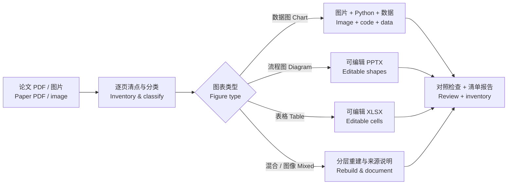

# PaperFigure-Redraw

**把论文中的图表转化为可编辑、可追溯、可复现的研究素材。**  
**Turn figures in papers into editable, traceable, reproducible research assets.**

[中文](#中文) | [English](#english)



## 中文

### 功能

将论文 PDF、截图或单张图交给 Codex 或 Claude Code，调用本 Skill 后，智能体会识别图表类型并选择适合的复现方式。对于整篇 PDF，工作流要求逐页检查、建立图表和子图清单，逐项处理并报告完成情况；支持用户提供的附录和补充材料。

| 输入类型 | 目标交付物 |
| --- | --- |
| 折线图、柱状图、散点图等 | PNG、SVG/PDF、可运行 Python 代码、数据文件 |
| 流程图、框图、结构示意图 | 可编辑的 PowerPoint 形状、文字和连接线，以及预览 |
| 数据表格 | 可编辑 Excel 单元格及格式 |
| 混合多面板图 | 按组成部分组合上述交付物，并记录不可编辑部分 |

**边界：**这是一套指导智能体工作的 Skill，不是保证一键完美还原任意论文的独立程序。图像无法提供未显示的原始数据；估读值会标记来源与误差，缺失内容不会凭空编造。照片、显微图或复杂插图可能只能保留原图裁剪并重建可编辑标注。结果取决于 PDF 质量、数据可用性、工具和运行时间。整篇处理以清单报告完整、部分完成和受阻项目，不把截图当作复现。

### 安装

需要 Git、Codex 或 Claude Code，以及可执行 Python 和相关绘图、PPT、Excel 工具的环境。具体依赖由智能体根据任务安装；PDF 清点脚本需要 `python -m pip install pymupdf`。

先克隆本仓库，进入仓库目录：

```bash
git clone https://github.com/AphroditeYu/PaperFigure-Redraw.git
cd PaperFigure-Redraw
```

安装到当前项目：在目标项目根目录执行以下命令，`/path/to/PaperFigure-Redraw` 换成本仓库的实际路径。

**Codex（macOS/Linux）：**

```bash
mkdir -p .agents/skills
cp -R /path/to/PaperFigure-Redraw/skills/paperfigure-redraw .agents/skills/
```

**Claude Code（macOS/Linux）：**

```bash
mkdir -p .claude/skills
cp -R /path/to/PaperFigure-Redraw/skills/paperfigure-redraw .claude/skills/
```

**Windows PowerShell：**在目标项目根目录运行，将路径替换为实际克隆位置：

```powershell
New-Item -ItemType Directory -Force .agents/skills | Out-Null
Copy-Item -Recurse 'C:\path\to\PaperFigure-Redraw\skills\paperfigure-redraw' '.agents/skills/'
# Claude Code 改用 .claude/skills 作为目标目录
```

用户级安装可分别复制到 `~/.agents/skills/`（Codex）或 `~/.claude/skills/`（Claude Code）。复制整个 Skill 文件夹，保留 `SKILL.md`、`references` 和 `scripts`。重新启动或开启新会话以便发现 Skill。更多信息见 [Codex Skills](https://developers.openai.com/codex/skills/) 和 [Claude Code Skills](https://code.claude.com/docs/en/skills)。

### 使用

在新会话附上 PDF 或图片，例如：

```text
使用 $paperfigure-redraw 复现这篇 PDF 中所有图表，
保留每个子图，输出图片、代码、数据、可编辑 PPT/Excel，
并列出无法准确还原的项目和原因。
```

Claude Code 中可以输入 `/paperfigure-redraw` 并附上文件和要求。也可指定单张图、输出目录、目标格式或数据源。对于大型论文，建议允许智能体分批处理并检查最终清单。

PDF 辅助清点（只生成候选清单，仍需逐页人工或智能体视觉检查）：

```bash
python skills/paperfigure-redraw/scripts/pdf_inventory.py paper.pdf --out work/inventory
```

### 典型输出

```text
results/
  inventory.json             # 页码、状态、来源和校验
  report.md                  # 差异、估计方法与受阻项目
  figure-01/
    reference.png
    figure.png
    figure.svg
    data.csv
    redraw.py
  figure-02/diagram.pptx
  table-01/table.xlsx
```

## English

### What it does

Give an agent a PDF, screenshot, or figure. The skill routes quantitative charts to reproducible plots, code and data; diagrams to editable PowerPoint shapes; and tables to editable Excel cells. For an entire PDF it inventories every page and panel, processes items in batches, and reports complete, partial and blocked work. User-supplied appendices and supplements are included.

**Limits:** This is an agent skill, not a standalone guarantee of perfect one-click reproduction. Fidelity depends on source quality, data access, available tools and time. Values digitized from images are estimates; missing observations are not invented. Photographs, microscopy, and complex illustrations may require a labeled reference crop with editable overlays. A screenshot alone is not counted as a reconstruction.

### Install

Clone this repository:

```bash
git clone https://github.com/AphroditeYu/PaperFigure-Redraw.git
```

Copy the complete `skills/paperfigure-redraw` directory to `.agents/skills/` in your project for Codex, or `.claude/skills/` for Claude Code. For user-wide installation, use `~/.agents/skills/` or `~/.claude/skills/` respectively. See the commands above for macOS, Linux and PowerShell. Start a new session. Requirements depend on the requested output; the optional PDF helper requires `python -m pip install pymupdf`.

### Example

Attach a paper or image and ask:

```text
Use $paperfigure-redraw to recreate every figure and table in this PDF.
Include each panel, runnable code, data, editable PowerPoint/Excel where
appropriate, and a report of approximations and blocked items.
```

In Claude Code, invoke `/paperfigure-redraw` with the attachment. Inspect the inventory and report before using reconstructed results in research. The PDF helper renders pages and finds candidate captions; it is not an automatic complete figure detector.

### Responsible use

Respect authors' rights and access restrictions. Original data is preferable to digitized estimates. Reconstructed scientific images should not be represented as original experimental evidence. Review all results before publication.

## License

MIT. See [LICENSE](LICENSE).

